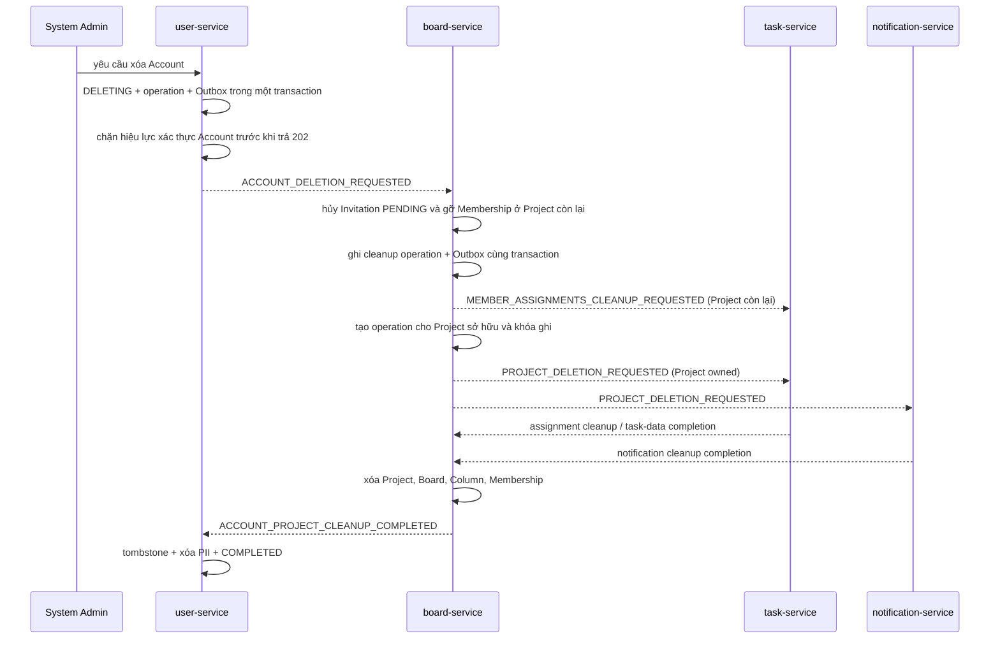

# Hướng dẫn hoàn thiện skeleton xóa Account và Project

**Ngày cập nhật:** 2026-10-28

**Trạng thái:** Scaffold biên kiến trúc và persistence, chưa phải luồng xóa chạy end-to-end.

Tài liệu này hướng dẫn hoàn thiện từng service theo quyết định tại [architecture-decisions.md](architecture-decisions.md). Các payload trong `shared/event-contracts` là hình dạng tạm để các module biên dịch cùng nhau; chúng chưa phải event contract cuối cùng.

## Hiện trạng skeleton

Các tài liệu riêng được đồng bộ tại [user API](../../services/user-service/docs/api.md) / [user database](../../services/user-service/docs/database.md), [board API](../../services/board-service/docs/api.md) / [board database](../../services/board-service/docs/database.md), [task API](../../services/task-service/docs/api.md) / [task database](../../services/task-service/docs/database.md), [notification API](../../services/notification-service/docs/api.md) / [notification database](../../services/notification-service/docs/database.md). Chúng tách route/schema runtime khỏi thiết kế Project-first mục tiêu; danh sách dưới đây mô tả phần cascade scaffold cụ thể trong code.

- `shared/event-contracts` có event envelope versioned và DTO tạm cho Account/Project deletion, cleanup Notification, cleanup assignment và completion.
- Tên constant event trong Java viết hoa; wire `eventType` hiện là chuỗi chữ thường có dấu chấm (ví dụ `account.deletion.requested`). Đây là mapping provisional, chưa phải event schema cuối cùng.
- `shared/messaging-support` cung cấp Outbox/Inbox entity và repository dùng trong DB cục bộ của từng service, transactional Outbox writer, Inbox recorder, cùng Relay dùng correlated Publisher Confirms và Publisher Returns. Exchange chỉ được khai báo khi `dev-platform.messaging.enabled=true`; Relay mặc định tắt.
- `user-service` có `AccountStatus.ACTIVE/DELETING`, operation record, tombstone, request/get use-case ports, transaction ghi Account `DELETING` + operation + Outbox, và completion handler dùng Inbox.
- `board-service` có operation record cho từng Project và `ProjectDeletionDataPort`/`ProjectDeletionCoordinator` boundary. Chưa có Project, Membership, Invitation hoặc adapter thật trong service này.
- `task-service` có deletion job/checkpoint shape, write-lock table/guard và query theo lô cho Card/Comment. Chưa có listener, worker hoặc wiring guard vào các mutation.
- `notification-service` có deletion job/checkpoint shape và query Notification theo `boardId`. Chưa có listener, worker hoặc completion publisher.
- Compose có RabbitMQ management container. Các service không kết nối hoặc tiêu thụ message tự động khi chạy với cấu hình mặc định.

## Luồng mục tiêu



Khi xóa Account, `DELETING` phải chặn Account-wide authentication trước khi API khởi tạo trả `202`. Khi xóa Membership ở Project còn tồn tại, quyền Project bị thu hồi hiệu lực trước response xác nhận việc gỡ Member; flow không đợi Task unassign. Task-service xử lý assignment cleanup nền, retry được và giữ Comment/history. Vì request authorization có thể dựa trên Redis snapshot, snapshot cũ không được cấp quyền sau revoke; chỉ phát event qua RabbitMQ bất đồng bộ chưa tự bảo đảm điều đó. Cơ chế invalidation/fencing cụ thể và cách xử lý khi không xác nhận được revoke vẫn cần chốt, fail closed.

`operationId` theo dõi yêu cầu xóa Account; mỗi Project sở hữu có `projectDeletionId`; từng message có `eventId` ổn định qua lần gửi lại. Inbox chống lặp theo cặp `consumerName + eventId`. Unique key của deletion job còn phải chống lặp ở cấp nghiệp vụ nếu cùng operation được phát thành event mới.

## Hoàn thiện theo service

### 1. `user-service`

Các điểm bắt đầu là `application/service/AccountDeletionApplicationService`, `AccountDeletionPersistenceAdapter`, `AccountDeletionCompletionHandler` và `AccountAccessGuard`.

1. Hoàn thiện `LoginUserPort` và gọi `AccountAccessGuard.requireActive` trước khi phát token. Repo hiện chưa có implementation `LoginUserPort`, nên status `DELETING` hiện **chưa chặn đăng nhập thực tế**.
2. Chốt Admin route, status route, response và lỗi nghiệp vụ. Sau đó mới thêm controller; Gateway phải cung cấp Admin identity đáng tin cậy. Không bật API khi Gateway chưa xác thực/ủy quyền.
3. Thêm queue/binding và listener cho `ACCOUNT_PROJECT_CLEANUP_COMPLETED`. Listener chỉ ACK sau khi transaction của Inbox + tombstone + xóa PII + cập nhật operation commit thành công.
4. Khi nhận yêu cầu trùng `eventId`, handler phải trả thành công mà không chạy side effect lần hai. Khi `operationId` không tồn tại hoặc account không khớp, cần chốt lỗi/retry thay vì đánh dấu hoàn tất.

### 2. `board-service`

Các boundary nằm trong `services/board-service/src/main/java/dev/platform/board/deletion/`.

1. Thêm `Project`, `ProjectMember`, `Invitation` vào `board_db`; thêm `project_id` cho Board. Dùng model theo quyết định Project-first; không tạo `project-service` riêng ở Kỳ 1.
2. Implement `ProjectDeletionDataPort`: tìm Project theo Owner/Member, lấy `boardIds`, hủy Invitation `PENDING`, gỡ Membership ở Project còn lại để thu hồi quyền hiệu lực trước, và ghi operation/Outbox assignment cleanup cùng transaction. Với Project owned, tạo write barrier và xóa Project graph thuộc board_db sau xác nhận downstream.
3. Implement `ProjectDeletionCoordinator`: tạo operation con theo `projectDeletionId`; phát yêu cầu Task/Notification theo `boardIds`; chờ task-data và notification completion trước khi xóa Project/Board/Column/Membership.
4. Với Project mà account chỉ là Member, membership đã bị thu hồi trước khi gửi cleanup event; chờ `MemberAssignmentsCleaned` chỉ để hoàn tất account-deletion operation, không phải điều kiện chặn quyền. Chỉ gửi completion cho User Service khi cả Project sở hữu và cleanup membership đều hoàn tất.
5. Project `ACTIVE/COMPLETED/CANCELLED` vẫn giữ nguyên ý nghĩa. Khóa xóa là operation riêng; không thêm trạng thái `DELETING` vào status Project.
6. Trước khi cho cùng User quay lại Project khi cleanup cũ còn pending, áp dụng policy đã chốt: chặn re-invite/Accept/assign đến khi cleanup xong hoặc gắn generation/cutoff. Nếu chưa chốt, chưa bật flow vì event cũ có thể xóa assignment mới.

### 3. `task-service`

Các boundary nằm trong `services/task-service/src/main/java/dev/platform/task/deletion/`; checkpoint hiện có cursor riêng cho Comment và Card.

1. Implement consumer cho Project cascade và member assignment cleanup. Ghi Inbox + deletion job với unique `deduplicationKey` trong cùng transaction trước khi ACK; assignment cleanup phải an toàn khi Account đã bị gỡ khỏi Project.
2. Implement worker theo batch giới hạn: xóa Comment trước Card; lưu cursor sau mỗi batch; nếu dữ liệu đã vắng mặt thì coi thao tác xóa lặp là đạt trạng thái mong muốn.
3. Khi nhận cleanup event sau khi membership đã bị thu hồi, clear assignee trên Card của các Board trong Project; giữ Comment và attribution lịch sử. Không dùng việc unassign hoàn tất làm điều kiện thu hồi quyền Project. Worker phải giới hạn cleanup vào membership generation/cutoff bị revoke, hoặc board-service phải ngăn rejoin/assignment mới cho tới khi job hoàn tất.
4. Gọi `TaskWriteGuard.requireBoardWritable` trong tất cả đường ghi Card: create, move, assign, comment. Hiện các mutation implementation chưa nối guard; không bật consumer cho cascade cho tới khi write barrier được bảo đảm giữa Board và Task Service.
5. Ghi completion Outbox trong transaction hoàn tất job cuối; nếu broker lỗi, Outbox Relay gửi lại cùng `eventId` và payload.

### 4. `notification-service`

Các boundary nằm trong `services/notification-service/src/main/java/dev/platform/notification/deletion/`.

1. Chốt phạm vi notification: skeleton chỉ định xóa notification gắn với `boardIds`; xử lý notification không gắn Board hoặc toàn bộ notification theo Account vẫn còn mở.
2. Implement consumer ghi Inbox + job trước ACK, rồi worker xóa theo batch/cursor và phát completion Outbox sau khi hết dữ liệu.
3. Dùng `projectDeletionId` làm khóa duy nhất của job để một yêu cầu xóa Project không tạo nhiều job do redelivery.
4. Ghi deletion fence/tombstone bền cho Board/Project và buộc mọi consumer tạo Notification kiểm tra fence trước insert; Inbox riêng lẻ không chặn event khác ID đến muộn sau khi batch delete xong. Chốt field/version/retention trước khi bật listener.

## Bật tích hợp sau khi hoàn thiện

1. Chốt event payload/version, retry/backoff, DLQ/alert, route Admin và write-lock barrier trong hợp đồng API/event.
2. Implement adapter, listener, queue/binding và worker cho từng service; thêm schema migration thay cho dựa vào `ddl-auto=update` trước khi cần giữ dữ liệu.
3. Cấu hình `RABBITMQ_HOST`, `RABBITMQ_PORT`, `RABBITMQ_USERNAME`, `RABBITMQ_PASSWORD`; bật `MESSAGING_ENABLED=true` để khai báo exchange.
4. Chỉ bật `OUTBOX_RELAY_ENABLED=true` sau khi RabbitMQ có topology đúng. `OUTBOX_RELAY_RETRY_DELAY` và `OUTBOX_RELAY_CONFIRM_TIMEOUT` hiện là giá trị cấu hình tạm, chưa phải retry/DLQ policy đã chốt.
5. Chỉ bật listener/consumer sau khi Inbox + business/job transaction, retry/DLQ và write-lock barrier đã hoàn chỉnh. Bản skeleton chưa khai báo queue/binding hoặc Rabbit listener.
6. Không bật `ACCOUNT_DELETION_ADMIN_API_ENABLED` ở skeleton này: chưa có controller, Admin authorization và login guard thực tế.

## Kiểm tra scaffold

Từ thư mục gốc `Dev-Platform`:

```powershell
mvn -DskipTests compile
docker compose config
```

Hai lệnh trên chỉ kiểm tra biên dịch và cấu hình Compose; chúng không chứng minh cascade đã chạy end-to-end. Không có dữ liệu legacy cần chuyển theo ghi chú quyết định hiện tại, nhưng cần kiểm tra DB thực tế trước khi chạy migration.
