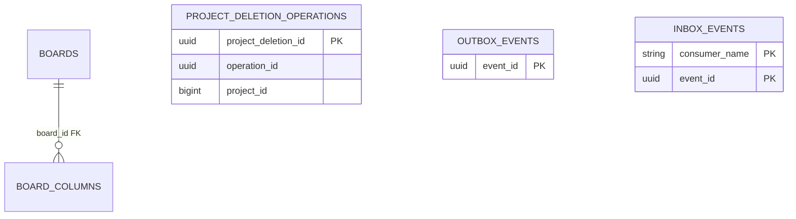
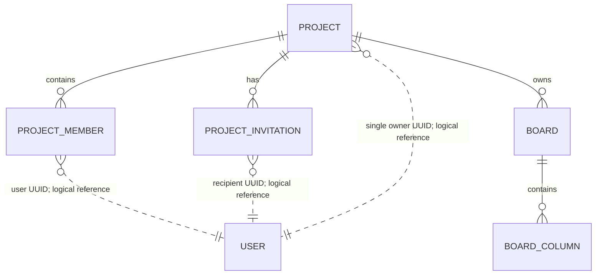

# board_db — database do board-service sở hữu

**Database local:** `board_db` (PostgreSQL). Project và Board cùng thuộc database này theo topology Kỳ 1. Tài liệu phân biệt mapping trong skeleton với schema mục tiêu Project-first.

**Thiết kế mục tiêu Kỳ 1:** board-service sở hữu Project, ProjectMember, Invitation, Board và Column. Mỗi Project có một Owner; Membership unique theo `(project_id, user_id)`; Invitation `PENDING` chỉ tạo Membership sau khi Accept. Board thuộc Project, `key` lowercase unique trong Project. Các quan hệ còn thiếu DDL được ghi ở phần ERD mục tiêu; Outbox/Inbox lưu trong `board_db`.

**Ghi chú source:** skeleton còn các class `domain.Board` và `domain.BoardColumn` được đánh dấu `@Deprecated` cùng mapping hạ tầng mới. Đây là tình trạng code, không phải schema mục tiêu cần giữ nguyên.

## Mapping trong skeleton hiện tại

### `boards`

| Cột | Kiểu/mapping | Constraint |
|---|---|---|
| `id` | BIGINT | PK, `IDENTITY` |
| `name` | varchar(255) | not null |
| `board_key` | varchar(20) | not null, unique toàn bảng |
| `owner_id` | UUID | not null; tham chiếu logic tới Account, không FK chéo DB |

Board hiện được sở hữu trực tiếp bởi `owner_id`. Không có `project_id`. Key validation hiện cũ theo chữ hoa/số; đó không phải quy tắc key mục tiêu.

### `board_columns`

| Cột | Kiểu/mapping | Constraint |
|---|---|---|
| `id` | BIGINT | PK, `IDENTITY` |
| `board_id` | BIGINT | not null; quan hệ JPA tới `boards` |
| `name` | varchar(100) | not null |
| `position` | integer | not null |

`BoardEntity.columns` có `cascade=ALL` và `orphanRemoval=true`, được đọc theo `position ASC`. Ba Column mặc định được tạo trong domain khi request không truyền danh sách rỗng; không phải dữ liệu mặc định trong DB.

## Scaffold operation cascade

### `project_deletion_operations`

| Cột | Kiểu/mapping | Constraint |
|---|---|---|
| `project_deletion_id` | UUID | PK |
| `operation_id` | UUID | not null; operation Account cha |
| `project_id` | BIGINT | not null |
| `board_ids_json` | TEXT | not null |
| `task_data_deleted`, `notifications_deleted` | boolean | not null |
| `status` | varchar(30) | not null; `PENDING`, `WAITING_FOR_DOWNSTREAM`, `COMPLETED`, `FAILED`; bắt đầu `PENDING` |
| `created_at`, `updated_at` | timestamptz | not null |

Entity có index trên `operation_id` và `project_id`. Hiện bảng operation có entity/repository nhưng chưa có Project graph hay coordinator adapter để chạy cascade.

## Thiết kế Project-first chưa có trong runtime schema

Các bảng Project, Membership và Invitation; quan hệ Board→Project; key chữ thường unique theo Project; trạng thái Project/Board và các constraint nghiệp vụ chưa có entity/migration trong service. Phần “Schema mục tiêu Project-first” bên dưới là logical design để lấp gap, không phải DDL đã duyệt. Field/length, index không suy ra từ quyết định, và cách thực thi một số invariant được đánh dấu đề xuất/còn mở thay vì coi là implementation contract.

## Messaging và ranh giới dữ liệu

Outbox/Inbox dùng mapping từ `shared/messaging-support` nhưng phải được lưu trong `board_db`. Card/Comment thuộc `task_db`; Notification thuộc `notification_db`. Không tạo JPA foreign key chéo database. Xem [API](api.md), [quyết định chung](../../../docs/project/architecture-decisions.md) và [hướng dẫn skeleton](../../../docs/project/account-deletion-skeleton-guide.md).

## ERD runtime

`boards` hiện không chứa `project_id`; vì vậy runtime ERD không vẽ quan hệ Board→Project deletion operation. `project_id` và `operation_id` trong bảng operation là scalar tham chiếu logic, không phải quan hệ JPA/FK sang Project hoặc user-service. `board_columns.board_id` là quan hệ JPA thật.

## Constraint, index và persistence detail

| Table | Keys/constraints/indexes | Quan hệ / hành vi |
|---|---|---|
| `boards` | PK `id`; unique `board_key` toàn bảng | `owner_id` UUID là tham chiếu logic tới Account; chưa có `project_id` |
| `board_columns` | PK `id`; `board_id`, `name`, `position` not-null | FK/JPA `ManyToOne` tới `boards`; Board collection dùng cascade `ALL` + `orphanRemoval`; load order `position ASC` |
| `project_deletion_operations` | PK `project_deletion_id`; index `operation_id`, `project_id` | Project/parent operation IDs là scalar, chưa có FK; `board_ids_json` lưu danh sách Board dạng TEXT |
| `outbox_events` | PK `event_id`; index `(status, next_attempt_at, created_at)` | Mapping shared được ghi trong `board_db` |
| `inbox_events` | Composite PK `(consumer_name, event_id)` | Mapping shared được ghi trong `board_db` |

Không có index khai báo cho `board_columns.board_id` hoặc unique theo cặp `(board_id, position)`. Cần chốt và tạo bằng migration nếu query/ordering production yêu cầu. `board_key` runtime uppercase và unique toàn DB; không tương đương key lowercase unique trong Project ở target.

## Schema mục tiêu Project-first (logical design, chưa phải DDL đã duyệt)

Các bảng dưới đây là thiết kế logical để lấp schema gap, không khẳng định table/entity/migration đã tồn tại. Rule nghiệp vụ chốt và field/constraint đề xuất được tách rõ; schema migration phải có version, công cụ migration chưa chọn.

### `projects`

| Field | Kiểu mục tiêu | Khóa/null | Trạng thái |
|---|---|---|---|
| `id` | BIGINT | PK, not null | ID Project số đã thống nhất |
| `name` | varchar | not null | Field cần có; length/normalization còn mở |
| `status` | varchar/enum | not null; `ACTIVE`, `COMPLETED`, `CANCELLED` | Tập giá trị đã chốt; transition chưa chốt |
| `created_at`, `updated_at` | timestamptz | đề xuất not null | Audit field đề xuất |

Owner được biểu diễn ở `project_members` với role `OWNER`, tránh hai nguồn `owner_id`/membership không đồng nhất. API `ownerId` có thể được suy ra từ Owner membership. Đây là schema recommendation cần duyệt trước DDL.

### `project_members`

| Field | Kiểu mục tiêu | Khóa/null | Trạng thái |
|---|---|---|---|
| `project_id` | BIGINT | PK part, FK → `projects.id`, not null | Cùng board_db nên có FK vật lý |
| `user_id` | UUID | PK part, not null | User service sở hữu; chỉ là logical reference, không FK cross-DB |
| `role` | varchar/enum | not null; `OWNER` hoặc `MEMBER` | Role Project; Admin hệ thống không phải role tại đây |
| `joined_at` | timestamptz | đề xuất not null | Audit field đề xuất |

Constraint chốt: unique `(project_id,user_id)`. Đề xuất partial unique index trên `project_id WHERE role='OWNER'` để chặn hơn một Owner; tạo Project và Owner membership trong cùng transaction để bảo đảm ít nhất một Owner. Owner không thể tự rời/gỡ; Member rời hoặc bị gỡ thì membership bị xóa trước, assignment cleanup chạy nền.

### `project_invitations`

| Field | Kiểu mục tiêu | Khóa/null | Ý nghĩa/trạng thái |
|---|---|---|---|
| `invitation_id` | UUID | PK, not null | ID riêng; kiểu/strategy còn là đề xuất |
| `project_id` | BIGINT | FK → `projects.id`, not null | Project nhận lời mời |
| `invited_user_id` | UUID | not null, logical reference | User đã tồn tại; không FK sang `user_db` |
| `invited_by_user_id` | UUID | not null, logical reference | Actor Owner |
| `status` | varchar/enum | not null | `PENDING`, `ACCEPTED`, `REJECTED`, `CANCELLED`, `EXPIRED` là tập đề xuất; chỉ Accept tạo Membership |
| `created_at` | timestamptz | đề xuất not null | Thời điểm tạo |
| `responded_at`, `expires_at` | timestamptz | nullable | Field thời gian đề xuất; expiry policy chưa chốt |

Đề xuất partial unique `(project_id,invited_user_id) WHERE status='PENDING'` để chặn pending trùng; index `(invited_user_id,status,created_at)` cho inbox lời mời và `(project_id,status,created_at)` cho Owner list lời mời trong Project. Thời hạn, mời lại sau REJECTED/CANCELLED/EXPIRED và giữ lịch sử Invitation cần chốt.

Board-service phải xác thực `invited_user_id` còn tồn tại/ACTIVE lúc create và revalidate khi Accept; client search không phải integrity check. Không có FK tới `user_db`. Vì Internal REST chưa sẵn sàng, nguồn check/freshness (ví dụ versioned Account snapshot) và hành vi khi không xác minh được còn là blocker trước migration/endpoint.

### `boards` và `board_columns`

| Table/field | Kiểu mục tiêu | Khóa/constraint | Ghi chú |
|---|---|---|---|
| `boards.id` | BIGINT | PK | ID Board số |
| `boards.project_id` | BIGINT | FK → `projects.id`, not null | Project và Board cùng board_db |
| `boards.name` | varchar | not null | Chiều dài/validation cần chốt |
| `boards.board_key` | varchar | not null; unique `(project_id,board_key)` | Chốt lowercase và unique trong Project; đề xuất DB check lowercase |
| `boards.status` | varchar/enum | not null; `ACTIVE`, `COMPLETED`, `CANCELLED` | Tập status đã chốt; transition chưa chốt |
| `boards.created_by_user_id` | UUID | logical reference | Audit actor, đề xuất; không quyết định quyền |
| `boards.created_at`, `updated_at` | timestamptz | đề xuất | Audit fields cần chốt |
| `board_columns.id` | BIGINT | PK | ID Column số |
| `board_columns.board_id` | BIGINT | FK → `boards.id`, not null | Cascade khi xóa Board |
| `board_columns.name` | varchar | not null | Chiều dài và uniqueness/case-folding cần chốt |
| `board_columns.position` | integer | not null | Order trong Board; index `(board_id,position)` đề xuất |

Index đề xuất: unique `(project_id,board_key)` cho Board picker/lookup; `(project_id,status)` nếu lọc theo trạng thái; `(board_id,position)` cho thứ tự Column. Chưa chốt unique `(board_id,position)`: nếu cần constraint này, reorder phải dùng cập nhật hai bước hoặc unique constraint deferred để tránh va chạm giữa các vị trí trong cùng transaction. Các index ngoài unique key chưa benchmark.

### Cleanup operations và messaging

`project_deletion_operations` hiện có ở skeleton: `project_deletion_id` UUID PK, `operation_id` UUID, `project_id` BIGINT, `board_ids_json`, flags xác nhận Task/Notification, status và timestamps. Giữ operation record sau khi graph bị xóa; không FK tới `projects` để không cản xóa. Status/response/event fields cuối cùng còn mở.

Đề xuất bảng `member_assignment_cleanup_operations`: `cleanup_operation_id` UUID PK; `operation_id` UUID của account deletion nếu có; `project_id` BIGINT; `target_user_id` UUID; `board_ids_json`; `status`; `attempt_count`; `last_error`; `created_at`, `updated_at`, `completed_at`. Mọi ID ngoài `board_db` là scalar. Tạo operation + Outbox `MEMBER_ASSIGNMENTS_CLEANUP_REQUESTED` trong cùng transaction Membership revoke; API không chờ Task worker. Cần chốt unique business dedupe key và quan hệ operation con với account operation khi một Account thuộc nhiều Project.

### Authorization revocation và cleanup/rejoin race

Membership revoke phải chặn quyền hiệu lực trước khi API xác nhận thành công; assignment cleanup chỉ chạy nền. Outbox/RabbitMQ async không thể tự loại bỏ snapshot Redis cũ khỏi quyết định authorization. Nếu cần cache rebuild hoặc kiểm tra version, schema mục tiêu phải giữ được thông tin revoke/version sau khi row Membership bị xóa. Bảng revocation ledger/tombstone (ví dụ `project_id`, `user_id`, `membership_version`, `revoked_at`) là phương án đề xuất, chưa được chọn; Redis key/schema và điểm đồng bộ trước response vẫn mở.

Failure path cần lưu được: Membership + Outbox đã commit nhưng Redis fence chưa được xác nhận. Chỉ dựa vào row Membership đã xóa sẽ không đủ để request retry tiếp tục việc revoke. Có thể dùng durable `authorization_revocation_operations` trong `board_db` gồm `revocation_id` UUID PK, `project_id`, `user_id`, `membership_version`, `status`, `requested_at`, `confirmed_at`, `last_error`; IDs bên ngoài vẫn là scalar. Đây là schema candidate, chưa được chốt. Retry/reconciler phải tiếp tục fence; endpoint không trả thành công khi quyền vẫn có thể được cấp từ snapshot cũ. Tên status, uniqueness và thứ tự Redis/DB commit cần chốt cùng với cơ chế authorization.

Khi `member_assignment_cleanup_operations` còn hoạt động, một lời mời/Accept lại có thể đua với worker cũ và làm worker bỏ `assignee_id` của lần tham gia mới. Cần chọn trước migration: chặn re-invite/Accept/assign cho cặp `(project_id,user_id)` đến khi cleanup COMPLETED, hoặc gắn membership/assignment generation để cleanup chỉ chạm đúng generation đã revoke. Không dùng unique pending Invitation để giả định race này đã được giải quyết.

`outbox_events`/`inbox_events` được tạo riêng trong `board_db`. Inbox unique `(consumer_name,event_id)`; Outbox event retry giữ cùng `eventId`, `schemaVersion`, `aggregateVersion` và payload. Xem [shared mappings](../../../shared/README.md#physical-table-mappings).

### Invariant, index và ranh giới

- Project tạo cùng Owner membership; Membership unique theo `(project_id,user_id)`; Account được mời phải tồn tại và chỉ có Membership sau khi Accept.
- `project_id` là owner boundary cho mọi Board; `board_id`/`project_id` references trong DB này dùng FK nội bộ. Không tạo FK tới `user_db`, `task_db` hoặc `notification_db`.
- Gỡ Member: thu hồi membership trước; unassign Card nền; giữ Comment/attribution. Redis snapshot cũ không được dùng để cấp quyền sau khi membership đã bị gỡ; cơ chế invalidation/fencing còn mở.
- Membership revoke phải có một điểm đồng bộ khiến request tiếp theo bị từ chối trước response thành công; RabbitMQ event là propagation/cleanup, không phải bằng chứng revoke đã có hiệu lực.
- ID Invitation, field audit, unique pending invitation, expiry, status transitions và operation state machine là đề xuất cần chốt; không được coi là DDL đã duyệt.

## Database local và migration

- Compose tạo `board_db` trên PostgreSQL port `5433`; `board-service` mặc định dùng `localhost:5433/board_db`.
- Local config hiện dùng `spring.jpa.hibernate.ddl-auto=update`, `show_sql=true`. Repo chưa có migration SQL/Flyway/Liquibase; đây không phải migration strategy production.
- Outbox/Inbox entities của `shared/messaging-support` được scan và lưu trong `board_db`; không có database `shared_db`.
- Cột/kiểu chi tiết của bảng messaging chung xem [shared physical mappings](../../../shared/README.md#physical-table-mappings); mapping được tạo riêng trong `board_db`.
- Project, Membership, Invitation và `boards.project_id` chưa có entity/repository/migration trong code hiện tại. Schema mục tiêu ở trên là logical design, không khẳng định persistence đã tồn tại.
