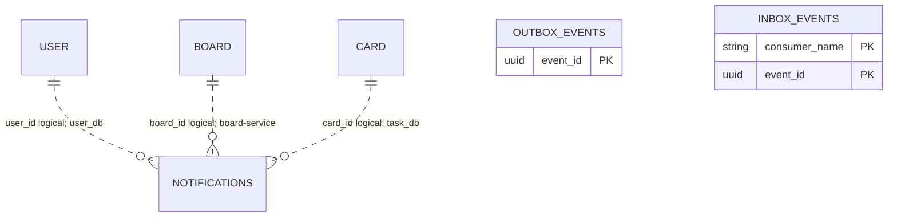

# notification_db — database do notification-service sở hữu

**Database local:** `notification_db` (PostgreSQL). Tài liệu ghi mapping trong skeleton và phạm vi sở hữu mục tiêu; schema triển khai cần migration có version.

**Thiết kế mục tiêu Kỳ 1:** notification-service sở hữu Notification trong `notification_db`; user, board và card chỉ được tham chiếu bằng ID logic. Outbox/Inbox nằm trong `notification_db`. Phạm vi Notification phải xóa khi cascade Project vẫn là quyết định mở và được đánh dấu ở phần mô hình đích.

**Ghi chú source:** skeleton còn `domain.Notification` (`@Deprecated`) bên cạnh `NotificationEntity`. Khác biệt giữa hai mapping được ghi dưới đây để giải thích source hiện tại, không phải quyết định schema mục tiêu.

## Bảng `notifications`

| Cột | Kiểu/mapping | Constraint |
|---|---|---|
| `id` | BIGINT | PK, `IDENTITY` |
| `user_id` | UUID | not null; tham chiếu logic tới Account, không FK chéo DB |
| `type` | varchar(30) | not null; builder mặc định `ASSIGNED` |
| `title` | varchar(500) | not null |
| `card_id`, `board_id` | BIGINT | nullable; ID tham chiếu logic, không FK chéo DB |
| `read` | boolean | not null; builder mặc định `false` |
| `created_at` | timestamptz | nullable theo mapping hiện tại |

Entity khai báo index `(user_id, read)` để hỗ trợ danh sách Notification chưa đọc. Các kiểu thực tế hiện có trong domain/API phải được đối chiếu với `NotificationType`; không coi `PR_REVIEWED` là type đã được duyệt cho Kỳ 2.

## Scaffold cascade

### `notification_deletion_jobs`

| Cột | Kiểu/mapping | Constraint/default |
|---|---|---|
| `project_deletion_id` | UUID | PK, not null |
| `operation_id` | UUID | not null |
| `project_id` | BIGINT | not null |
| `board_ids_json` | TEXT | not null |
| `status` | varchar(20) | not null; `PENDING`, `PROCESSING`, `COMPLETED`, `FAILED`; constructor khởi tạo `PENDING` |
| `last_processed_notification_id` | BIGINT | nullable; constructor khởi tạo 0 |
| `attempt_count` | integer | not null; constructor khởi tạo 0 |
| `last_error` | TEXT | nullable |
| `created_at`, `updated_at` | timestamptz | not null |

Entity khai báo index `idx_notification_deletion_status(status, created_at)`. Operation/Project IDs là scalar, không có FK tới board-service.

Repository hiện có query tối đa 100 Notification theo Board IDs và ID cursor. Chưa có worker, Inbox transaction, listener hoặc completion Outbox. Scope xóa Notification chưa chốt cho dữ liệu không có Board ID.

## Messaging và ownership

Outbox/Inbox mapping dùng chung được lưu trong `notification_db`. Notification service không sở hữu User, Project, Board, Card hoặc Comment. Xem [API](api.md), [quyết định chung](../../../docs/project/architecture-decisions.md) và [skeleton guide](../../../docs/project/account-deletion-skeleton-guide.md).

## ERD runtime và quan hệ

`user_id`, `board_id`, `card_id` là scalar ID; NotificationEntity không khai báo JPA association/FK sang database khác. Job chỉ lưu scope Board IDs dạng JSON, chưa có FK tới Notification.

## Keys, constraints, indexes và query behavior

| Table | Keys/constraints/indexes | Quan hệ và lưu ý |
|---|---|---|
| `notifications` | PK `id`; index `(user_id, read)`; `user_id`, `type`, `title`, `read` not-null | `card_id`/`board_id` nullable; không có FK cross-database |
| `notification_deletion_jobs` | PK `project_deletion_id`; index `(status, created_at)` | `operation_id`, `project_id`, `board_ids_json`, cursor, attempts và error lưu tiến độ; không có FK |
| `outbox_events` | PK `event_id`; index `(status, next_attempt_at, created_at)` | Shared Outbox nằm trong `notification_db` |
| `inbox_events` | Composite PK `(consumer_name, event_id)` | Shared Inbox nằm trong `notification_db` |

Repository list theo `user_id` và `created_at DESC`; chế độ unread lọc `read=false`. Cleanup query batch tối đa 100 theo `board_id`/ID tăng dần; entity không khai báo index cho `board_id, id`, nên đây chưa phải index design được tối ưu/đã benchmark.

## Mô hình đích và cleanup boundary

Notification vẫn do `notification-service` sở hữu và trỏ logic tới Account/Card/Board. Project được xác định qua Board trong mô hình hiện tại, nhưng Notification không lưu `project_id`. Thiết kế target cần chốt việc chỉ xóa notification thuộc Boards của Project hay cả notification không gắn Board; không thêm column/index giả định trước quyết định đó.

## Schema mục tiêu Kỳ 1 — thiết kế để hoàn thiện

Đây là logical schema từ API hiện có và cascade target; không phải migration đã tồn tại. Schema change phải có migration version; công cụ migration chưa được chọn.

### `notifications`

| Field | Kiểu mục tiêu | Khóa/null | Ghi chú |
|---|---|---|---|
| `id` | BIGINT | PK | ID Notification số |
| `user_id` | UUID | not null, logical reference | Recipient; Account thuộc user_db, không FK cross-DB |
| `type` | varchar/enum | not null | Demo dùng `ASSIGNED`, `MENTIONED`, `MOVED`; danh mục target cần chốt |
| `title` | varchar(500) | not null | Message hiển thị |
| `card_id` | BIGINT | nullable, logical reference | Card thuộc task_db |
| `board_id` | BIGINT | nullable, logical reference | Board thuộc board_db; dùng xác định phạm vi cascade |
| `read` | boolean | not null, default false | Mark-read state |
| `created_at` | timestamptz | target đề xuất not null | Source mapping hiện cho phép null |

Không thêm `project_id` chỉ để cascade nếu Board→Project đã nằm trong board-service: board-service gửi danh sách `boardIds`, Notification service lọc theo `board_id`. Nếu cần xóa notification không gắn Board thì phải có rule riêng; đó là quyết định mở.

### Query index đề xuất

- Danh sách Notification của một user theo thời gian: `(user_id, created_at DESC, id DESC)`.
- Lọc unread rồi sắp xếp: `(user_id, read, created_at DESC, id DESC)`; có thể thay bằng partial index `WHERE read=false` sau khi đo query.
- Cascade cleanup theo Board: `(board_id,id)` để xóa theo batch/cursor.
- Các index này là thiết kế đề xuất, không được khai báo ở mapping runtime đầy đủ; xác nhận bằng query plan sau khi có schema/volume thực.

### `notification_deletion_jobs`, Outbox/Inbox

Skeleton job hiện dùng `project_deletion_id` UUID làm PK, `operation_id`, `project_id`, `board_ids_json`, status, notification cursor, attempts/error/timestamps. Giữ job bền để retry batch; không xóa notification trước khi consumer có Inbox + job transaction. Các IDs Project/Board/Account là scalar reference, không FK chéo DB.

Outbox/Inbox được lưu riêng trong `notification_db`; Inbox unique `(consumer_name,event_id)`. Consumer ACK sau khi Inbox và durable job/business effect commit; completion Outbox giữ cùng operation context nhưng event mới có eventId mới. Bảng physical mapping xem [shared documentation](../../../shared/README.md#physical-table-mappings).

Phạm vi cascade đang mở: xóa Notification gắn các Board của Project, hay cả dữ liệu không gắn Board; cách xử lý Notification của Account bị xóa trong Project vẫn còn cũng cần đối chiếu với retention lịch sử. Không tự suy ra từ bảng hiện tại.

### Fence chống Notification đến muộn sau cascade (schema requirement, thiết kế còn mở)

Inbox chỉ chống xử lý lại cùng `eventId`; nó không chặn một event `ASSIGNED`/`MENTIONED`/`MOVED` khác ID nhưng đang chờ trong broker khi deletion job hoàn tất. Nếu consumer tạo Notification sau khi đã xóa xong, dữ liệu của Board bị xóa sẽ xuất hiện lại.

Trước khi bật consumer, notification-service cần ghi một durable deletion fence cho Board/Project trong cùng transaction với Inbox + deletion job, và mọi handler tạo Notification phải kiểm tra fence đồng bộ trước khi insert. Bản thiết kế dữ liệu có thể dùng `notification_board_deletion_fences(board_id BIGINT PRIMARY KEY, project_deletion_id UUID, fenced_at timestamptz, source_version BIGINT NULL)`; đây là proposal, chưa được chốt. Board ID là scalar, không FK sang `board_db`. Retention/cleanup fence, quan hệ version giữa delete và event tạo, cùng cách xử lý event chạy đồng thời với worker đều cần chốt. Không coi việc xóa theo batch hoặc Inbox là đủ để chống event đến muộn.

## Database local và migration

- Compose tạo `notification_db` trên PostgreSQL port `5435`; service mặc định dùng `localhost:5435/notification_db`.
- Local config dùng `spring.jpa.hibernate.ddl-auto=update`, `show_sql=true`. Repo chưa có migration SQL/Flyway/Liquibase; production schema cần migration có version.
- Shared Outbox/Inbox entities được scan và lưu trong `notification_db`; mỗi service có bảng riêng, không chia sẻ database.
- Chi tiết cột chung của `outbox_events`/`inbox_events` xem [shared physical mappings](../../../shared/README.md#physical-table-mappings).
- `notification_deletion_jobs` chỉ là persistence shape. Chưa có listener, Inbox/job transaction, batch worker hay completion publisher.
