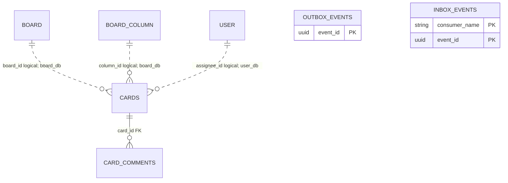
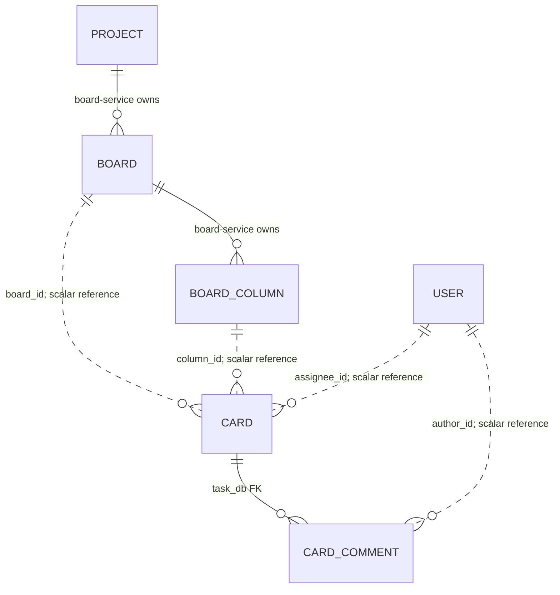

# task_db — database do task-service sở hữu

**Database local:** `task_db` (PostgreSQL). Tài liệu tách mapping trong skeleton khỏi thiết kế mục tiêu; Card/Comment thuộc task-service và migration schema chưa được chốt.

**Thiết kế mục tiêu Kỳ 1:** task-service sở hữu Card và Comment trong `task_db`; `boardId`, `columnId`, `assigneeId` và `authorId` là tham chiếu logic, không có FK xuyên database. Khi Member rời/bị gỡ hoặc Account bị xóa, Card được unassign nhưng lịch sử Comment được giữ. Cascade xóa Project xóa Card/Comment thuộc các Board của Project. Outbox/Inbox nằm trong `task_db`.

**Ghi chú source:** skeleton còn class `domain.Card`/`domain.CardComment` được đánh dấu `@Deprecated` bên cạnh các mapping hạ tầng mới. Những khác biệt giữa chúng được ghi dưới đây để giải thích source hiện tại, không phải quyết định schema mục tiêu.

## Mapping Card và Comment trong skeleton

### `cards`

| Cột | Kiểu/mapping | Constraint |
|---|---|---|
| `id` | BIGINT | PK, `IDENTITY` |
| `board_id`, `column_id` | BIGINT | not null; ID tham chiếu logic sang board-service, không FK chéo DB |
| `title` | varchar(500) | not null |
| `description` | TEXT | nullable |
| `status` | varchar(30) | Java builder mặc định `TODO`; field mapping hiện nullable |
| `position` | integer | builder mặc định 0, not null |
| `assignee_id` | UUID | nullable; tham chiếu logic tới Account |
| `due_date` | timestamptz | nullable |

`CardEntity` hiện không khai báo `@Index`; index theo board/column/position trong tài liệu cũ chưa được định nghĩa trong entity này.

### `card_comments`

| Cột | Kiểu/mapping | Constraint |
|---|---|---|
| `id` | BIGINT | PK, `IDENTITY` |
| `card_id` | BIGINT | not null; quan hệ JPA tới Card trong cùng DB |
| `author_id` | UUID | not null; tham chiếu logic tới Account |
| `content` | TEXT | not null |
| `created_at` | timestamptz | nullable theo mapping hiện tại |

`CardEntity` trong skeleton không khai báo association tới Comment; class cũ `domain.Card` có collection Comment với `cascade=ALL` và `orphanRemoval=true`. Đây là khác biệt giữa các mapping source, không phải quyết định cho schema mục tiêu. Scaffold cascade hiện dùng query/job batch nhưng worker chưa được nối.

## Scaffold xóa theo batch

### `task_deletion_jobs`

| Cột | Kiểu/mapping | Constraint/default |
|---|---|---|
| `job_id` | UUID | PK, not null |
| `deduplication_key` | varchar(200) | unique, not null |
| `job_type` | varchar(40) | not null; `PROJECT_CASCADE` hoặc `MEMBER_ASSIGNMENT_CLEANUP` |
| `operation_id` | UUID | not null |
| `project_deletion_id` | UUID | nullable |
| `project_id` | BIGINT | nullable |
| `board_ids_json` | TEXT | not null |
| `target_user_id` | UUID | nullable; dùng cho assignment cleanup |
| `status` | varchar(20) | not null; `PENDING`, `PROCESSING`, `COMPLETED`, `FAILED`; constructor khởi tạo `PENDING` |
| `last_processed_comment_id`, `last_processed_card_id` | BIGINT | nullable; constructor khởi tạo 0 |
| `attempt_count` | integer | not null; constructor khởi tạo 0 |
| `last_error` | TEXT | nullable |
| `created_at`, `updated_at` | timestamptz | not null |

Index `idx_task_deletion_status(status, created_at)`. Các UUID/ID liên kết operation, Project, Board, User là scalar, không có FK sang service/database khác.

### `board_write_locks`

| Cột | Kiểu/mapping | Constraint |
|---|---|---|
| `board_id` | BIGINT | Primary key, not null |
| `project_deletion_id` | UUID | not null; tham chiếu logic tới operation do board-service sở hữu |
| `created_at` | timestamptz | not null |

Đây là persistence shape cho barrier xóa, chưa được gắn vào mọi mutation.

Repo có query batch tối đa 100 Card/Comment theo Board IDs và ID cursor; Card indexes chưa được thiết kế theo cursor mục tiêu. Không coi query batch hiện có là implementation của API cursor list Card.

## Messaging và ownership

Outbox/Inbox mapping từ `shared/messaging-support` lưu trong `task_db`. task-service sở hữu Card/Comment và job cleanup; Project, Membership, Column và Notification không thuộc database này. Xem [API](api.md) và [quyết định chung](../../../docs/project/architecture-decisions.md).

## ERD runtime và quan hệ



Chỉ `card_comments.card_id` là quan hệ JPA trong `task_db`. Board, Column, Account là service khác sở hữu; các ID scalar không tạo cross-database FK.

## Keys, constraints, indexes và query behavior

| Table | Keys/constraints/indexes | Quan hệ và lưu ý |
|---|---|---|
| `cards` | PK `id`; `title` not-null/length 500; `board_id`, `column_id`, `position` not-null | Không khai báo `@Index`; `status` không bị DB mapping đánh not-null; `assignee_id` là UUID nullable |
| `card_comments` | PK `id`; `card_id`, `author_id`, `content` not-null | `CardCommentEntity` có `ManyToOne` tới CardEntity; class `domain.Card` trong skeleton có cascade `ALL`/orphan removal |
| `task_deletion_jobs` | PK `job_id`; unique `deduplication_key`; index `(status, created_at)` | Cursor/checkpoint và lỗi retry là dữ liệu job; `board_ids_json` lưu TEXT |
| `board_write_locks` | PK `board_id` | `project_deletion_id` là UUID tham chiếu operation logic; chưa có FK |
| `outbox_events` | PK `event_id`; index `(status, next_attempt_at, created_at)` | Outbox trong `task_db` |
| `inbox_events` | Composite PK `(consumer_name, event_id)` | Inbox trong `task_db` |

Card list query hiện sort theo `board_id, position ASC` hoặc `board_id, column_id, position ASC`. Batch cleanup lấy tối đa 100 record theo Board IDs và ID cursor tăng dần. Entity chưa khai báo index hỗ trợ các query này; không coi query cleanup là endpoint pagination.

## Mô hình ownership đích



Trong target, Project là ranh giới authorization nhưng Card/Comment vẫn thuộc `task_db`; không nhân bản Membership làm nguồn chuẩn và không tạo FK cross-database. Khi Member rời/bị gỡ hoặc Account bị xóa, assignee được gỡ nhưng lịch sử Comment được giữ. Chi tiết write barrier/cascade và status còn mở theo [architecture decisions](../../../docs/project/architecture-decisions.md).

## Schema mục tiêu Kỳ 1 — thiết kế để hoàn thiện

Đây là logical schema để triển khai cursor API và cleanup đã thống nhất; không phải migration đã tồn tại. Field cơ bản theo Card/Comment hiện có; tên constraint/index bên dưới là đề xuất cần rà lại với query thật. Schema change phải có migration version; công cụ migration chưa chọn.

### `cards`

| Field | Kiểu mục tiêu | Khóa/null | Ý nghĩa |
|---|---|---|---|
| `id` | BIGINT | PK | ID Card số |
| `board_id` | BIGINT | not null, logical reference | Board thuộc board_db; không cross-DB FK |
| `column_id` | BIGINT | not null, logical reference | Column thuộc Board; Task phải xác minh cùng Board |
| `title` | varchar(500) | not null | Tên Card |
| `description` | TEXT | null | Nội dung chi tiết |
| `status` | varchar/enum | nullability/tập giá trị còn mở | Demo có TODO/IN_PROGRESS/DONE nhưng không cập nhật khi move; cần chốt có bỏ hay derive từ Column |
| `position` | integer hoặc rank | not null | Thứ tự trong Column; cách renumber/rank cần giữ nhất quán với cursor |
| `assignee_id` | UUID | null | User reference; sau Member removal được xóa ở background |
| `due_date` | timestamptz | null | Thời điểm có timezone |
| `created_at`, `updated_at` | timestamptz | đề xuất | Audit fields cần chốt |

### `card_comments` và mention

`card_comments`: `id` BIGINT PK; `card_id` BIGINT FK → `cards.id`; `author_id` UUID logical reference tới Account; `content` TEXT not null; `created_at` timestamptz. Không xóa Comment khi author rời Project/bị xóa; UI hiển thị “Tài khoản đã bị xóa” hoặc “Tài khoản không còn trong Project”.

Mock API nhận `mentionedUserIds` nhưng response không trả danh sách này. Đề xuất bảng `card_comment_mentions(comment_id,user_id)` với PK `(comment_id,user_id)`, FK nội bộ `comment_id` tới Comment và `user_id` scalar UUID; cần duyệt trước khi triển khai vì schema/runtime hiện chưa có bảng này.

### Cursor và indexes

Agreed ordering: `position DESC, id DESC`, page size mặc định 5, tối đa 20. Vì UI tải từng Column, API proposal yêu cầu `column_id`; cursor opaque chứa hoặc xác thực scope `board_id`, `column_id`, sort contract cùng position+id để không dùng lẫn giữa các Column. Sai scope là `INVALID_CURSOR` proposal. Vì `id` unique, cặp `(position,id)` total order kể cả khi nhiều Column có cùng position. Query mục tiêu cho per-Column pagination là:

```sql
SELECT *
FROM cards
WHERE board_id = :boardId
  AND column_id = :columnId
  AND (
    position < :lastPosition
    OR (position = :lastPosition AND id < :lastId)
  )
ORDER BY position DESC, id DESC
LIMIT :limitPlusOne;
```

Index đề xuất cho list theo Column: `(board_id,column_id,position DESC,id DESC)`. Nếu API cho list xuyên các Column, index/order phải được thiết kế lại theo global key, không thể ngầm dùng index theo Column. Index đề xuất cho unassign/background cleanup: `(board_id,assignee_id,id)` hoặc `(assignee_id,board_id,id)` sau khi đối chiếu điều kiện query/batch. Index đề xuất cho comment list: `(card_id,created_at,id)`. PostgreSQL row-value comparison có thể thay OR nếu query planner phù hợp; cần đo bằng query plan, không khẳng định index hiện tại đã tối ưu.

Query hiện tại trong repository còn sort `position ASC`; đây là runtime mapping/query, không target cursor đã thống nhất. `columnId` là filter bắt buộc trong API proposal nếu chọn infinite-scroll từng Column. Nếu muốn list toàn Board bằng một cursor, cần đổi scope/contract/index theo quyết định riêng; không phải vì `(position,id)` mất total order khi bỏ `columnId`.

### `task_deletion_jobs`, `board_write_locks`, Outbox/Inbox

Skeleton đã có persistence shape `task_deletion_jobs`: `job_id` UUID PK; `deduplication_key` unique; `job_type` (`PROJECT_CASCADE`/`MEMBER_ASSIGNMENT_CLEANUP`); operation/project/projectDeletion IDs; `board_ids_json`; `target_user_id`; `status`; Card/Comment checkpoints; attempts/error/timestamps. Giữ unique job key để cùng operation không lặp side effect dù có event ID khác. Status/error/checkpoint lifecycle cần worker contract.

Với `MEMBER_ASSIGNMENT_CLEANUP`, worker chỉ được bỏ assignment thuộc membership generation đã bị revoke. Nếu thiết kế chọn block rejoin/assign tới khi cleanup xong, job phải giữ key `(project_id,target_user_id)` để board-service biết lúc nào mở lại; nếu chọn generation, event/job và dữ liệu assignment cần mang generation/cutoff. Chọn một trong hai trước khi đóng schema; nếu cleanup chỉ lọc `board_id + assignee_id`, event cũ có thể xóa assignment mới của lần tham gia sau.

`board_write_locks` dùng `board_id` PK để chặn write trong Project cascade; `project_deletion_id` là scalar operation reference. Không dùng lock cascade để trì hoãn membership revoke: Project access bị chặn trước, assignment cleanup của Member chạy nền. Ghi Inbox + durable job/checkpoint cùng transaction trước ACK; cleanup update Card assignee là idempotent.

Outbox/Inbox được lưu riêng trong `task_db`, dùng mapping shared; Inbox PK `(consumer_name,event_id)`. Consumer xử lý lại event cùng ID thì skip side effect và ACK sau khi Inbox đã commit. Chi tiết cột xem [shared mappings](../../../shared/README.md#physical-table-mappings).

## Database local và migration

- Compose tạo `task_db` trên PostgreSQL port `5434`; service mặc định dùng `localhost:5434/task_db`.
- Local config dùng `spring.jpa.hibernate.ddl-auto=update`, `show_sql=true`. Repo chưa có migration SQL/Flyway/Liquibase; production schema cần migration có version.
- Job/checkpoint/lock là persistence shape; chưa có listener, Inbox/job transaction, worker hoặc completion publisher. Các bảng tồn tại không có nghĩa cleanup chạy.
- Outbox/Inbox entities được scan từ shared module và lưu trong `task_db`, không dùng database chung.
- Chi tiết tất cả cột của `outbox_events`/`inbox_events` dùng chung được giữ tại [shared physical mappings](../../../shared/README.md#physical-table-mappings).
