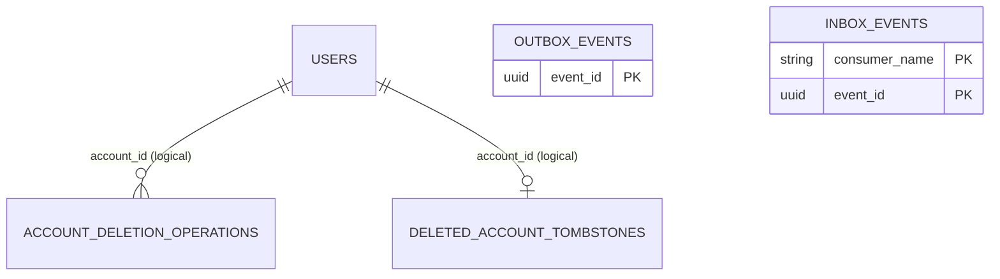

# user_db — database do user-service sở hữu

**Database local:** `user_db` (PostgreSQL). Tài liệu tách mapping trong skeleton hiện tại khỏi thiết kế mục tiêu; schema triển khai vẫn cần migration có version.

**Thiết kế mục tiêu Kỳ 1:** user-service sở hữu Account/Auth, trạng thái Account, account-deletion operation và tombstone giữ định danh tối thiểu. Outbox/Inbox được lưu trong `user_db`. Schema chi tiết của Account lifecycle phải theo [quyết định kiến trúc](../../../docs/project/architecture-decisions.md); phần dưới đây có mục riêng về source skeleton.

**Ghi chú source:** skeleton còn `domain.User` (`@Deprecated`) và `UserEntity` cùng map vào `users`. Đây là tình trạng code, không phải schema mục tiêu cần giữ nguyên.

## Mapping Account trong skeleton

### `users`

| Cột | Kiểu/mapping | Constraint |
|---|---|---|
| `id` | UUID | Primary key; tạo bằng `GenerationType.UUID` |
| `email` | varchar(255) | not null, unique |
| `password_hash` | varchar | not null |
| `full_name` | varchar(255) | nullable |
| `status` | varchar(20) | not null; enum `ACTIVE` hoặc `DELETING`; mặc định trong builder là `ACTIVE` |

`password_hash` không được trả trong response API. Các service khác chỉ giữ User UUID làm tham chiếu, không tạo foreign key xuyên database.

## Dữ liệu operation xóa Account trong skeleton

### `account_deletion_operations`

| Cột | Kiểu/mapping | Constraint |
|---|---|---|
| `operation_id` | UUID | Primary key |
| `account_id` | UUID | not null |
| `status` | varchar(20) | not null; `PENDING`, `PROCESSING`, `COMPLETED`, `FAILED`; bắt đầu `PENDING` |
| `created_at`, `updated_at` | timestamptz | not null |

Entity khai báo index `(account_id, created_at)`. Operation hiện mới được tạo cùng trạng thái Account và Outbox; API truy vấn tiến độ chưa được expose.

### `deleted_account_tombstones`

| Cột | Kiểu/mapping | Constraint |
|---|---|---|
| `account_id` | UUID | Primary key |
| `deleted_at` | timestamptz | not null |

Tombstone phục vụ giữ dấu vết Account đã xóa để các attribution lịch sử có thể hiển thị đúng. Completion flow chưa được nối end-to-end.

## Bảng messaging dùng chung

Mỗi service lưu Outbox/Inbox trong database do chính service sở hữu; module dùng chung định nghĩa mapping, không tạo database dùng chung.

- `outbox_events`: `event_id` (PK), `event_type`, `aggregate_type`, `aggregate_id`, `aggregate_version`, `payload`, `status`, `attempt_count`, `created_at`, `next_attempt_at`, `sent_at`, `last_error`. Có index cho trạng thái/thời điểm retry.
- `inbox_events`: composite key `(consumer_name, event_id)`, kèm `event_type` và `received_at`.
- `OutboxEventWriter` yêu cầu transaction đang tồn tại; `InboxEventRecorder` cũng yêu cầu transaction đang tồn tại.
- Outbox Relay hiện dùng confirm/return và retry theo cấu hình; relay/listener không mặc định bật và chưa phải policy retry/DLQ đã chốt.
- Bảng cột/kiểu/nullability đầy đủ của hai mapping chung nằm tại [shared physical mappings](../../../shared/README.md#physical-table-mappings); cùng mapping này được tạo riêng trong `user_db`.

## Sở hữu dữ liệu

user-service sở hữu Account, credential, status, account deletion operation và tombstone. Membership, Invitation, Project, Board, Card, Comment và Notification thuộc database/service khác. Xem [API/status](api.md) và [quyết định chung](../../../docs/project/architecture-decisions.md).

## ERD runtime và quan hệ

Hai quan hệ tới Account là liên kết logic trong code, không phải JPA association/foreign key. Tombstone giữ UUID tối thiểu sau khi row `users` bị xóa; operation không cascading-delete theo Account.

## Bảng chi tiết và index

| Table | Khóa/unique | Quan hệ và index | Ghi chú mapping |
|---|---|---|---|
| `users` | `id` PK; `email` unique | Không có FK khai báo | `password_hash` là `String` not-null; `status` lưu enum dạng chuỗi, `ACTIVE`/`DELETING` |
| `account_deletion_operations` | `operation_id` PK | `idx_account_deletion_account(account_id, created_at)` | `account_id` là UUID tham chiếu logic; status lưu chuỗi |
| `deleted_account_tombstones` | `account_id` PK | Không có FK/index phụ khai báo | `deleted_at` là `OffsetDateTime`/`timestamptz` |
| `outbox_events` | `event_id` PK | `idx_outbox_due(status, next_attempt_at, created_at)` | Do `shared/messaging-support` cung cấp và lưu ngay trong `user_db` |
| `inbox_events` | Composite PK `(consumer_name, event_id)` | Không có index phụ khai báo | Một event được khử trùng theo từng consumer |

Entity `users` không khai báo index ngoài unique email. Column kiểu `String` không chỉ rõ `length` dùng default của JPA/provider khi tạo schema; schema production phải được mô tả bằng migration thay vì dựa vào mặc định này.

## Database local, schema và vòng đời dữ liệu

- Compose tạo `user_db` trên PostgreSQL port `5432`; service mặc định kết nối `localhost:5432/user_db`.
- `spring.jpa.hibernate.ddl-auto=update` và `show_sql=true` là cấu hình local hiện tại. Repo chưa có migration SQL/Flyway/Liquibase; `update` không phải quy trình migration production có version.
- `account_deletion_operations` và Outbox phải được ghi cùng transaction khi yêu cầu xóa được nhận; Inbox cùng thay đổi nghiệp vụ phải cùng transaction consumer. Cấu trúc bảng đã có, nhưng completion consumer chưa được Rabbit listener nối vào.
- Sau khi cascade xác nhận, adapter hiện tạo tombstone rồi xóa row Account và đánh dấu operation `COMPLETED`; flow này chưa được expose qua Admin API hoặc kết nối consumer end-to-end.

## Mô hình đích và phạm vi sở hữu

Trong thiết kế Project-first, `user_db` tiếp tục là nguồn dữ liệu chuẩn của Account/Auth. Project, Owner/Membership, Invitation, Board và Column không chuyển vào DB này; chỉ các UUID Account được service khác lưu làm tham chiếu logic. Schema/retention chính xác cho deleted-account identity và audit operation phải theo quyết định chung, không thêm FK chéo DB.

## Schema mục tiêu Kỳ 1 — thiết kế để hoàn thiện

Các bảng dưới đây mô tả dữ liệu cần có theo nghiệp vụ Kỳ 1; đây chưa phải migration/DDL đã triển khai. Những field có nhãn **đề xuất** cần chốt trước khi tạo migration. Mọi schema change khi implement phải có migration version; công cụ migration chưa được chọn.

### `users` (Account/Auth)

| Field | Kiểu mục tiêu | Null/khóa | Trạng thái và mục đích |
|---|---|---|---|
| `id` | UUID | PK, not null | Đã có trong skeleton; ID Account dùng xuyên service |
| `email` | varchar | not null, unique | Unique email đã có; chuẩn hóa hoa/thường chưa chốt |
| `password_hash` | varchar | not null | Đã có trong skeleton; tuyệt đối không trả qua API |
| `full_name` | varchar | nullability cần chốt | Đã có trong skeleton |
| `status` | enum/string | not null; `ACTIVE`, `DELETING` | `DELETING` chặn cấp token/thao tác mới; đã có ở mức domain |
| System Admin role | enum trên Account hoặc bảng role riêng | Chưa chốt | Cần cách lưu/kiểm tra Admin hệ thống; tuyệt đối không phải role Project và không cấp quyền Project |

Không thêm `project_id`, `project_role` hay FK sang board_db. Xóa Account Owner khởi tạo Project cascade; Account chỉ là Member không xóa Project của họ.

Admin tạo Account là nghiệp vụ hệ thống đã chốt, nhưng payload credential/provisioning (Admin đặt mật khẩu, mật khẩu tạm, hay flow reset lần đầu) chưa chốt. Không lưu plaintext password; API tạo tài khoản phải đi qua cùng quy tắc hash với login.

### `account_deletion_operations` và `deleted_account_tombstones`

`account_deletion_operations` theo dõi một yêu cầu Admin xóa Account bằng `operation_id` UUID (PK), `account_id` UUID (logical reference), `status`, `created_at`, `updated_at`; các trường lỗi/kết thúc và state machine chi tiết là đề xuất, cần chốt. Operation cùng đổi Account sang `DELETING` và Outbox `ACCOUNT_DELETION_REQUESTED` phải commit nguyên tử. Account-wide authorization phải bị revoke trước khi API trả `202`, không chờ board/task cleanup. Cần lưu trạng thái/receipt cho việc snapshot đã bị fence (ví dụ `authorization_revoked_at`, `last_error`) hoặc có cơ chế tương đương; field và retry design chưa được chốt. Nếu DB commit thành công mà Redis chưa xác nhận, retry/reconciler phải tiếp tục revoke, không coi event Rabbit bất đồng bộ là xác nhận. Status operation tối thiểu cần phân biệt đang chờ/đang xử lý/hoàn tất/lỗi có thể retry; tên chính thức còn mở.

`deleted_account_tombstones` giữ UUID Account và thời điểm xóa để history hiển thị nhãn “Tài khoản đã bị xóa”; không giữ PII trừ khi có yêu cầu riêng. Mapping runtime hiện có `account_id` PK và `deleted_at` not null.

Bulk profile lookup dùng `users.id`/`deleted_account_tombstones.account_id` để phân biệt Account còn tồn tại với Account đã xóa. Response chỉ cần UUID, display name khi còn tồn tại và tombstone flag khi đã xóa; profile không được biến thành nguồn dữ liệu Membership. Directory search chỉ trả `ACTIVE` Account. Kiểu tìm kiếm/chuẩn hóa email, field được tiết lộ và paging/limit còn mở; đề xuất index phải theo query được chốt, ví dụ functional index trên email/name đã normalize nếu prefix search được duyệt.

### Messaging

`outbox_events` và `inbox_events` được tạo **trong `user_db`**, không dùng DB chung. Producer ghi Account status + operation + Outbox trong một transaction. Completion consumer ghi Inbox cùng tombstone/xóa PII/đổi operation trong transaction. Xem [shared mapping](../../../shared/README.md#physical-table-mappings).

### Quan hệ/constraint mục tiêu

- `users.id` là nguồn chuẩn Account UUID; UUID trong các service khác là scalar reference, không có cross-database FK.
- Directory/profile API chỉ đọc Account do user-service sở hữu; không thêm Membership/Project foreign key hay role Project vào `user_db`.
- `account_deletion_operations.operation_id` là định danh workflow, không phải event dedupe key; mỗi event riêng dùng `event_id` và consumer Inbox.
- Tombstone tồn tại sau khi row `users` bị xóa để phân biệt attribution của tài khoản đã xóa với người đang hoạt động.
- Bảng, field/index nêu trên chưa có migration; không coi JPA `ddl-auto=update` là versioning.
