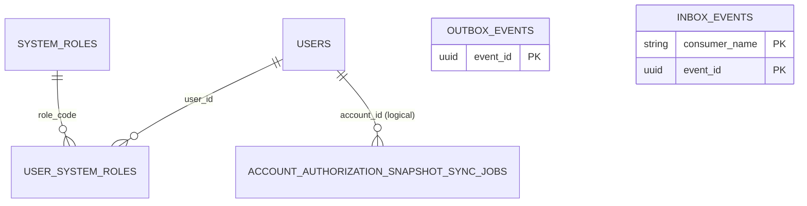

# user_db — database do user-service sở hữu

**Database local:** `user_db` (PostgreSQL). Tài liệu tách mapping trong skeleton hiện tại khỏi thiết kế mục tiêu; schema triển khai vẫn cần migration có version.

**Thiết kế mục tiêu Kỳ 1:** user-service sở hữu Account/Auth, trạng thái Account, `SystemRoles`/`UserSystemRoles`, `auth_version` và Account authorization snapshot-sync job. Outbox/Inbox được lưu trong `user_db`. Account deletion/operation/tombstone được hoãn sang Kỳ 2.

**Ghi chú source:** skeleton còn `domain.User` (`@Deprecated`) và `UserEntity` cùng map vào `users`. Đây là tình trạng code, không phải schema mục tiêu cần giữ nguyên.

## Mapping Account trong skeleton

### `users`

| Cột | Kiểu/mapping | Constraint |
|---|---|---|
| `id` | UUID | Primary key; tạo bằng `GenerationType.UUID` |
| `email` | varchar(255) | not null, unique |
| `password_hash` | varchar | not null |
| `full_name` | varchar(255) | nullable |
| `status` | varchar(20) | not null; runtime enum hiện tại được đọc từ source; Kỳ 1 không dùng `DELETING` |

`password_hash` không được trả trong response API. Các service khác chỉ giữ User UUID làm tham chiếu, không tạo foreign key xuyên database.

## System roles và authorization snapshot

`SystemRoles` định nghĩa system role; `UserSystemRoles` gán role cho Account. Đây là schema mục tiêu đã thống nhất, không phải Project role. `SYSTEM_ADMIN` chỉ quản trị Account và không tự cấp quyền Project.

| Bảng | Field mục tiêu | Constraint |
|---|---|---|
| `system_roles` | `role_code`, `description` | `role_code` là PK; seed role `USER` và `SYSTEM_ADMIN` |
| `user_system_roles` | `user_id`, `role_code`, `granted_at`, `granted_by` | PK `(user_id,role_code)`; FK nội bộ tới `users` và `system_roles` |
| `users` | `auth_version` | Version tăng khi Account status hoặc SystemRoles đổi |
| `account_authorization_snapshot_sync_jobs` | `job_id`, `account_id`, `auth_version`, `snapshot_json`, retry/status/timestamps | JPA skeleton map trong `user_db`; chưa có migration triển khai |

Mỗi lần đổi Account status/role, source row, Outbox event và snapshot-sync job phải commit trong cùng transaction. user-service retry apply snapshot vào Redis theo `auth_version`; Redis apply mới là mốc có hiệu lực trong authorization path. Bootstrap System Admin đầu tiên và API cấp/thu hồi role vẫn còn mở.

## Bảng messaging dùng chung

Mỗi service lưu Outbox/Inbox trong database do chính service sở hữu; module dùng chung định nghĩa mapping, không tạo database dùng chung.

- `outbox_events`: `event_id` (PK), `event_type`, `aggregate_type`, `aggregate_id`, `aggregate_version`, `payload`, `status`, `attempt_count`, `created_at`, `next_attempt_at`, `sent_at`, `last_error`. Có index cho trạng thái/thời điểm retry.
- `inbox_events`: composite key `(consumer_name, event_id)`, kèm `event_type` và `received_at`.
- `OutboxEventWriter` yêu cầu transaction đang tồn tại; `InboxEventRecorder` cũng yêu cầu transaction đang tồn tại.
- Outbox Relay hiện dùng confirm/return và retry theo cấu hình; relay/listener không mặc định bật và chưa phải policy retry/DLQ đã chốt.
- Bảng cột/kiểu/nullability đầy đủ của hai mapping chung nằm tại [shared README](../../../shared/README.md), mục `Physical table mappings`; cùng mapping này được tạo riêng trong `user_db`.

## Shared modules trong user-service

### Cách đọc

Đọc [hướng dẫn `shared/`](../../../shared/README.md) theo thứ tự ở đó: `event-contracts` để biết envelope/payload, `messaging-support` để biết Outbox/Inbox, rồi đối chiếu bảng vật lý và feature flags trong tài liệu này. Với quyết định nghiệp vụ hoặc event còn provisional, kiểm tra thêm [architecture decisions](../../../docs/project/architecture-decisions.md). `shared/` cung cấp code messaging; không chứa Redis Authentication/Authorization Snapshot.

### Tích hợp và trạng thái trong source

user-service khai báo `messaging-support`, import `MessagingSupportConfiguration` và scan entity/repository của shared. Vì vậy `outbox_events` và `inbox_events` được map vào `user_db`, không phải database riêng của shared.

- Snapshot recorder và Redis worker có skeleton; recorder chưa được gọi từ Account mutation use case. Khi nối lifecycle, recorder phải lưu Account/status/role Outbox event cùng durable sync job trong transaction nguồn. Worker retry Redis apply theo `auth_version` và chỉ chạy khi bật property.
- Outbox Relay dùng lại cùng event ID/version/payload khi retry. Mọi consumer tương lai ghi Inbox cùng thay đổi nghiệp vụ/job trước ACK.
- Các cờ messaging mặc định là `false`; cấu hình relay/consumer không đồng nghĩa snapshot sync đã chạy end-to-end.

## Sở hữu dữ liệu

user-service sở hữu Account, credential, status, SystemRoles/UserSystemRoles, Account authorization snapshot-sync job và Outbox/Inbox trong user_db. Membership, Invitation, Project, Board, Card, Comment và Notification thuộc service/database khác. Account deletion/tombstone thuộc Kỳ 2. Xem [API](api.md) và [quyết định chung](../../../docs/project/architecture-decisions.md).

## ERD runtime và quan hệ

`user_id` và `role_code` là quan hệ nội bộ trong user_db; ID được các service khác tham chiếu vẫn là scalar, không có FK xuyên database. Snapshot-sync job lưu trạng thái retry; Redis không phải nguồn dữ liệu chuẩn.

## Bảng chi tiết và index

| Table | Khóa/unique | Quan hệ và index | Ghi chú mapping |
|---|---|---|---|
| `users` | `id` PK; `email` unique | Không có FK liên service | `password_hash` không trả qua API; `auth_version` tăng theo đổi status/system role |
| `system_roles` | `role_code` PK | Không có index phụ | Danh mục role hệ thống; seed `USER`, `SYSTEM_ADMIN` |
| `user_system_roles` | Composite PK `(user_id,role_code)` | FK local tới `users`/`system_roles` | `granted_by` là audit reference; bootstrap Admin còn mở |
| `account_authorization_snapshot_sync_jobs` | `job_id` PK; unique `(account_id, auth_version)` | `idx_account_snapshot_sync_due(status, next_attempt_at)` | JPA skeleton cho Redis sync retry; chưa có migration |
| `outbox_events` | `event_id` PK | `idx_outbox_due(status, next_attempt_at, created_at)` | Do `shared/messaging-support` cung cấp và lưu ngay trong `user_db` |
| `inbox_events` | Composite PK `(consumer_name, event_id)` | Không có index phụ khai báo | Một event được khử trùng theo từng consumer |

Entity `users` không khai báo index ngoài unique email. Column kiểu `String` không chỉ rõ `length` dùng default của JPA/provider khi tạo schema; schema production phải được mô tả bằng migration thay vì dựa vào mặc định này.

## Database local, schema và vòng đời dữ liệu

- Compose tạo `user_db` trên PostgreSQL port `5432`; service mặc định kết nối `localhost:5432/user_db`.
- `spring.jpa.hibernate.ddl-auto=update` và `show_sql=true` là cấu hình local hiện tại. Repo chưa có migration SQL/Flyway/Liquibase; `update` không phải quy trình migration production có version.
- Account/status/system-role mutation, Outbox event và snapshot-sync job phải commit cùng transaction. Redis apply/retry là bước sau commit; snapshot cũ không được ghi đè version mới.
- Kỳ 1 không có Account deletion operation, tombstone hoặc cascade completion consumer. Schema/migration/versioning vẫn cần triển khai bằng công cụ migration được chọn.

## Mô hình đích và phạm vi sở hữu

Trong thiết kế Project-first, `user_db` là nguồn dữ liệu chuẩn của Account/Auth và system role. Project, Owner/Membership, Invitation, Board và Column không chuyển vào DB này; service khác giữ UUID Account dưới dạng scalar reference. Account deletion/Owner succession được thiết kế ở Kỳ 2.

## Schema mục tiêu Kỳ 1 — thiết kế để hoàn thiện

Các bảng dưới đây mô tả dữ liệu cần có theo nghiệp vụ Kỳ 1; đây chưa phải migration/DDL đã triển khai. Những field có nhãn **đề xuất** cần chốt trước khi tạo migration. Mọi schema change khi implement phải có migration version; công cụ migration chưa được chọn.

### `users` (Account/Auth)

| Field | Kiểu mục tiêu | Null/khóa | Trạng thái và mục đích |
|---|---|---|---|
| `id` | UUID | PK, not null | Đã có trong skeleton; ID Account dùng xuyên service |
| `email` | varchar | not null, unique | Unique email đã có; chuẩn hóa hoa/thường chưa chốt |
| `password_hash` | varchar | not null | Đã có trong skeleton; tuyệt đối không trả qua API |
| `full_name` | varchar | nullability cần chốt | Đã có trong skeleton |
| `status` | enum/string | not null | Dùng trạng thái Account Kỳ 1; không có `DELETING` |
| `auth_version` | bigint | not null | Tăng khi status hoặc SystemRoles đổi; version trên snapshot Redis |

`system_roles` chứa danh mục role hệ thống (`USER`, `SYSTEM_ADMIN`); `user_system_roles` gán role cho Account, khóa chính `(user_id,role_code)` và FK nội bộ tới `users`/`system_roles`. `SYSTEM_ADMIN` chỉ quản trị Account và không tự cấp Project access. Bootstrap Admin đầu tiên còn mở. Không nhận role do client tự gửi trong payload đăng ký/tạo Account.

Không thêm `project_id`, `project_role` hay FK sang `board_db`. Account deletion/Owner succession được hoãn sang Kỳ 2; Kỳ 1 không cascade/xóa Project khi Account thay đổi.

Admin tạo Account là nghiệp vụ hệ thống đã chốt, nhưng payload credential/provisioning (Admin đặt mật khẩu, mật khẩu tạm, hay flow reset lần đầu) chưa chốt. Không lưu plaintext password; API tạo tài khoản phải đi qua cùng quy tắc hash với login. Việc tạo Account không tự cấp `SYSTEM_ADMIN`; cơ chế bootstrap/cấp role cần được chốt riêng.

### Account deletion — Kỳ 2

Kỳ 1 không có `account_deletion_operations`, `deleted_account_tombstones`, Account deletion endpoint, `DELETING` status hoặc cascade consumer/job. Không thêm các bảng này vào schema Kỳ 1. Khi thiết kế Kỳ 2, cần làm rõ soft-delete, chuyển Owner cho Member đủ điều kiện tham gia sớm nhất và cách giữ attribution lịch sử.

### Messaging

`outbox_events` và `inbox_events` được tạo **trong `user_db`**, không dùng DB chung. Producer ghi Account status/role change + Outbox + snapshot-sync job trong một transaction. Kỳ 1 không có completion consumer cho Account deletion. Xem [shared mapping](../../../shared/README.md), mục `Physical table mappings`.

### Quan hệ/constraint mục tiêu

- `users.id` là nguồn chuẩn Account UUID; UUID trong các service khác là scalar reference, không có cross-database FK.
- Directory/profile API chỉ đọc Account do user-service sở hữu; không thêm Membership/Project foreign key hay role Project vào `user_db`.
- `auth_version` tăng khi Account status hoặc SystemRoles đổi; Redis chỉ có snapshot, không phải nguồn dữ liệu chuẩn.
- Account deletion operation và tombstone không thuộc schema Kỳ 1; thiết kế ở tài liệu Kỳ 2 khi phạm vi được mở lại.
- Bảng, field/index nêu trên chưa có migration; không coi JPA `ddl-auto=update` là versioning.
